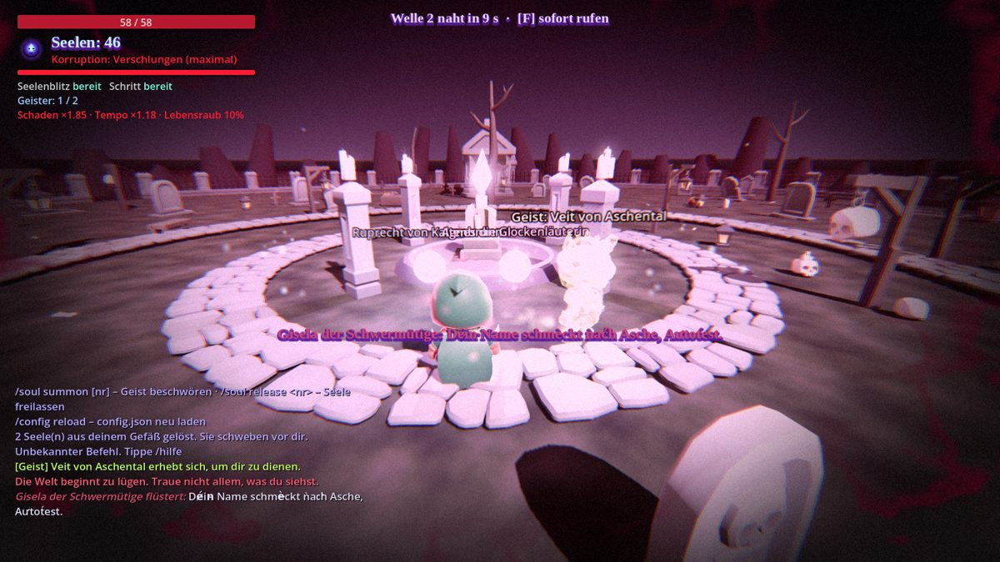
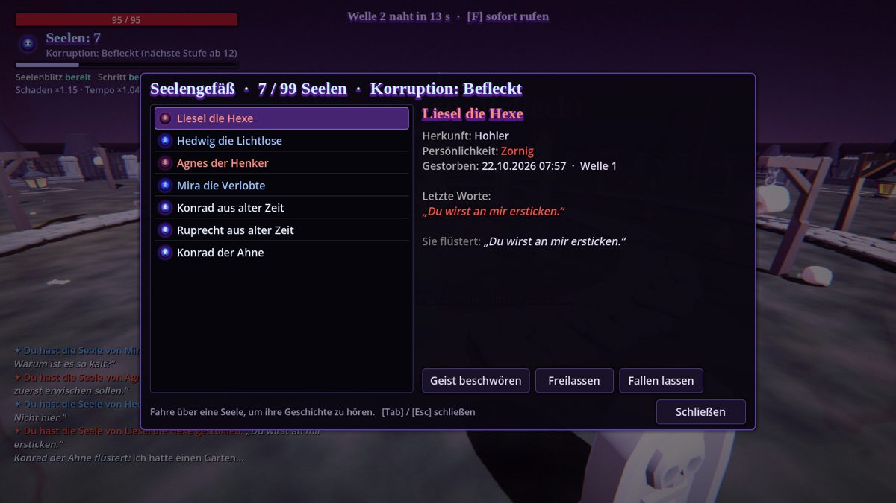
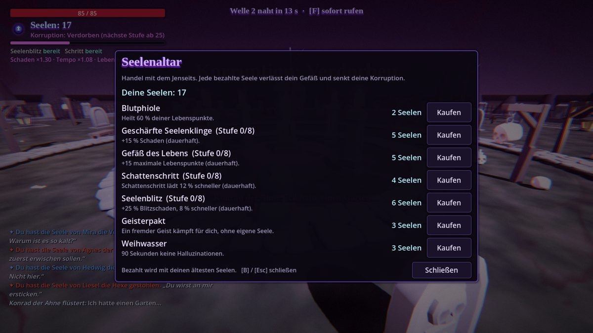
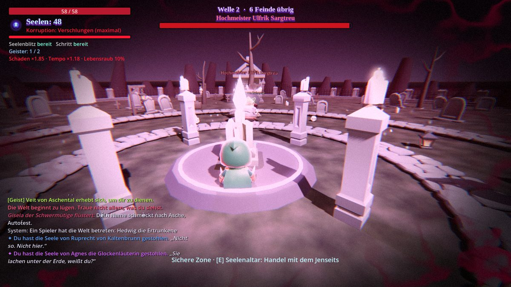
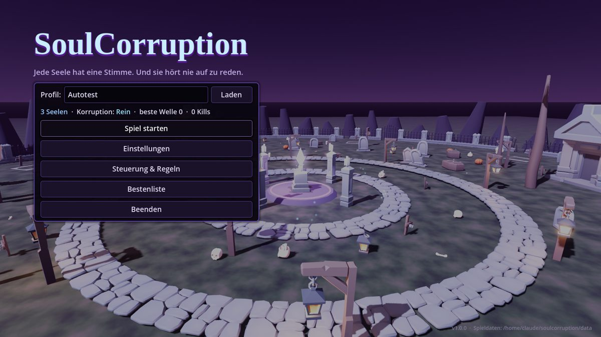

# SoulCorruption

Ein düsteres 3D-Action-Spiel für Windows. Du bist ein Seelendieb auf einem verfluchten Friedhof: Jeder starke Gegner war einmal ein Mensch mit Namen, Persönlichkeit und letzten Worten, und wenn er fällt, gehört seine Seele dir. Seelen machen dich stärker, aber sie flüstern, sie werden lauter, und irgendwann lügt dir die Welt ins Gesicht.



## Download & Start

Die fertige, portable **SoulCorruption.exe** wird bei jedem Push von GitHub Actions gebaut:
*Actions → „Build SoulCorruption“ → letzter Lauf → Artefakt `SoulCorruption-Windows`*.
Bei einem Tag `v*` (z. B. `v1.0.0`) landet die ZIP zusätzlich als Release.

- Keine Installation: entpacken, `SoulCorruption.exe` starten.
- Alles bleibt im Ordner: Spielstände und Config liegen in `SoulCorruption_Daten/` direkt neben der .exe. Ist der Ordner schreibgeschützt, wird nach `%APPDATA%\SoulCorruption` ausgewichen.
- Eine einzige Datei (~105 MB), Engine und Spieldaten sind eingebettet.

## Spielprinzip

| System | Umsetzung |
|---|---|
| **Seelen-Item** | Jede Seele ist ein echtes Item (`SoulItem`) mit Opfername, Herkunft, Persönlichkeit, Todeszeitpunkt, Welle und letzten Worten. In der Welt erscheint sie als leuchtender Orb (eigener Shader, Licht, Partikel, Namensschild). Im Seelengefäß zeigt Hover/Auswahl ihre Geschichte. Stapelbar oder einzeln (Config). |
| **Seelen-System** | Start mit konfigurierbarer Seelenzahl. Starke Gegner (Grabwächter, Ritter-Bosse) lassen ihre Seele immer fallen, schwache nur mit Chance. Jeder Tod kostet Seelen, die als Orb am Todesort liegen bleiben (oder verschwinden). Bei 0 Seelen: *Seelenlos*-Debuff, und der nächste Tod beendet den Lauf, oder wahlweise eine **Verbannung** für X Minuten. |
| **Flüstern** | Gehaltene Seelen flüstern im Chat und in der Actionbar, passend zu ihrer Persönlichkeit (zornig, verzweifelt, höhnisch, wahnsinnig, trauernd) oder als Echo ihrer letzten Worte. Mehr Seelen bedeuten häufigeres und aggressiveres Flüstern, ab Stufe 4 verzerrt. |
| **Korruption** | 5 Stufen (Rein → Verschlungen). Mehr Schaden, Tempo und Lebensraub, dafür weniger max. LP. Visuell: Vignette, Adern am Bildrand, Farbverschiebung, chromatische Aberration, roter Nebel, glühender Spielerumriss, Aura-Partikel. |
| **Halluzinationen** | Ab Stufe 3: Phantom-Gegner mit Namen deiner Seelen, gefälschte Chat-/Systemnachrichten, kleine Teleports, falsche Seelen-Orbs, Bildstörungen. |
| **Physik** | Skelette zerfallen beim Tod in Schädel, Knochen und Rippen, die physikalisch wegfliegen. Schädel, Kürbisse, Kerzen, Bänke und Särge liegen lose herum, lassen sich wegtreten und werden von Schlägen, Seelenblitzen und dem Erdstoß des Bosses weggeschleudert. |
| **Shop** | Seelenaltar (E am Altar oder B in Wellenpausen). Der Altarbereich (leuchtender Ring) ist eine **Safe Zone**: kein Schaden, Gegner kommen nicht hinein. Seelen sind die Währung, und jeder Kauf senkt deine Korruption: Heilung, dauerhafte Upgrades, Geisterpakt, Weihwasser gegen Halluzinationen. |
| **Geister-Begleiter** | Beschwöre den Geist einer gestohlenen Seele (G oder im Inventar). Er kämpft eine Weile und verabschiedet sich mit einer persönlichen Zeile. |
| **/soul-Befehle** | `balance`, `top`, `withdraw <n>`, `shop`, `list`, `info`, `summon`, `release`, dazu `/config reload`. |
| **Speicherung** | Pro Spielerprofil eine JSON-Datei (Seelen, Upgrades, Statistiken, Bann). Autosave und atomares Schreiben. |
| **Config** | `config.json` mit allen Werten (Chancen, Caps, Schwellen, Effektstärken, Shop-Preise, Wellen, Grafik, Audio). Fehlende Einträge werden automatisch ergänzt. |

<p>
 
 
</p>

## Steuerung

| Taste | Aktion |
|---|---|
| W A S D / Maus | Bewegen / Kamera |
| Linke Maustaste | Seelenklinge |
| Rechte Maustaste / Q | Seelenblitz |
| Leertaste / Shift | Schattenschritt (Dash) |
| E | Altar benutzen |
| Tab / I | Seelengefäß (Inventar) |
| B | Seelenhandel |
| G | Geist der jüngsten Seele beschwören |
| F | Nächste Welle sofort rufen |
| T / Enter | Chat und Befehle |
| Esc / F11 | Pause / Vollbild |

## Technik

- **Engine:** Godot 4.7.2, GDScript, Forward+ Renderer (fällt auf älterer Hardware automatisch auf OpenGL zurück)
- **Modelle & Animationen:** [KayKit](https://kaylousberg.itch.io/) von Kay Lousberg (Skeletons, Adventurers, Halloween Bits), Lizenz CC0. Lizenzdateien in `assets/kaykit/`.
- **Effekte & Sound:** eigene Shader (`shaders/`), Partikel und synthetisierte Klänge, alles im Code.
- **Struktur**
  - `scripts/autoload/`: `Cfg` (Config), `Souls` (Seelen-Persistenz), `Lore` (Namen, letzte Worte, Flüstern), `Sfx` (Klangsynthese)
  - `scripts/souls/`: Seelen-Item, Seelen-Orb, Geister-Begleiter
  - `scripts/actors/`: Spieler, Gegner (inkl. Phantome), Seelenblitz
  - `scripts/systems/`: Korruption, Flüstern, Halluzinationen, Wellen
  - `scripts/world/`: Arena, Welt (Seelenregeln), Build-Helfer
  - `scripts/ui/`: HUD, Inventar, Shop, Konsole, Menüs
- **Selbsttest:** `godot --headless --path . -- --autotest` spielt alle Systeme durch (Wellen, Seelenraub, Inventar, Shop, Befehle, Geister, Korruptionsstufen, Halluzinationen, Physik, Safe Zone, Boss, Tod, Speichern/Laden, Seelenlos, Bann). Läuft in CI im Editor und gegen den exportierten Build.

### Selbst bauen

1. [Godot 4.7.2](https://godotengine.org/download) und die passenden Export-Templates installieren.
2. Projekt öffnen → *Projekt → Exportieren → Windows Desktop*, oder per Kommandozeile:
   ```
   godot --headless --path . --export-release "Windows Desktop" build/windows/SoulCorruption.exe
   ```
